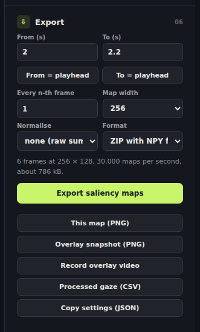
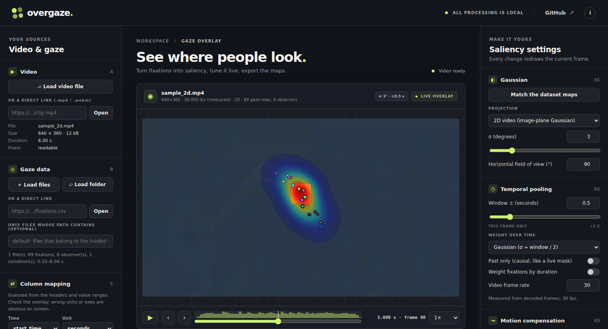

# OverGaze

OverGaze is a browser-based tool that lays eye-tracking gaze or fixations over a video, turns them into saliency maps with settings you can change while watching, and exports the maps. It handles 360° equirectangular (ERP) video and ordinary 2D video. Everything runs locally in the browser; files are not sent to a server. There is no build step, backend or dependency.


## Run locally

Serve the repository root with any static web server, then open it in Chrome:

```sh
python3 -m http.server 8000
# open http://localhost:8000
```

Do not double-click `index.html`: a page opened as a file cannot load its scripts, so nothing would work. OverGaze detects this and shows a red banner that says so. Local video files are opened in memory, so seeking works with any server.

## Host on GitHub Pages

Push the repository (`index.html`, `styles.css`, `src/`, `sample/`) to a branch, then **Settings → Pages → Deploy from a branch**, that branch and **/(root)**. The site is then at `https://<user>.github.io/OverGaze/`. Do not commit private datasets. All paths in the app are relative, so it works under a sub-path.

The address bar can open data and set options: `?sample` or `?sample=2d` load a bundled sample; `?video=<url>&gaze=<url1>,<url2>` loads a video and gaze files from links; `sigma=3`, `window=1`, `kernel=gaussian` (or `box`, `triangle`), `past`, `velocity=75`, `rotate=<degrees>` set options. Linked files must be served with CORS headers (see below).

## Inputs

**Video.** A local file (anything the browser plays: H.264, VP9 or AV1 in MP4 / WebM; H.265 only in some browsers) or a direct link to a video file. A link whose server sends no CORS headers still plays and gets the heatmap overlay and map export, but the browser does not let the page read its pixels, so motion analysis, snapshots and overlay recording are disabled. YouTube pages cannot be used: the page gets no access to the frames and YouTube shows a 360° viewport, not the ERP frame. Download the file (for example with yt-dlp) and open it from disk.

**Frame rate.** Browsers do not report it, so OverGaze measures it from decoded frames and snaps it to a common rate (23.976, 24, 25, 29.97, 30, 59.94, 60 …). WebM stores times in whole milliseconds, so the gaps of a 29.97 fps video alternate between 33 and 34 ms; the gaps are averaged, not sampled. You can also type the rate. This matters when a container says 29.97 and the video is really 25.

**Gaze.** CSV, TSV, semicolon- or space-separated text, JSON (array of records) or ARFF, as single files, several files (one per observer) or a whole dataset folder (**Load folder**). The column mapping is guessed from header names and value ranges and is fully editable:

- **Time** in seconds, milliseconds, microseconds, frame index from 0 or frame number from 1, plus an optional **time offset**. A frame number gives the centre of that frame (frame *k* covers [k/fps, (k+1)/fps)).
- **Duration** or **end time** for fixations. Without them each row is one gaze sample.
- **Horizontal / vertical** position as normalised 0–1, degrees, radians or pixels. The four "value at edge" fields define the linear mapping to the frame (longitude −180…180 or 0…360, latitude 90 at the top or 0 at the top, y from the bottom …). A **3D direction** option (x right, y up, z forward) is also available.
- **Observer** from a column, the file name, the folder name or none; **condition** from a column, the folder name, the folder above it, the file name or none.

### The two datasets this was built for

Both are recognised on sight; their usual settings are filled in and written in the notice under the video.

- **VR-EyeTracking** (`Gaze_txt_files/<observer>/<video number>._<date>_ori_0.txt`, rows `frame,<n>,forward,<head x>,<head y>,eye,<gaze x>,<gaze y>`). The label words are dropped, the eye position (`gaze x`, `gaze y`) is used as fractions of the panorama measured **from the bottom-left corner**, frame numbers count from 1, the observer is the `pNNN` folder, and the speed filter is set to 75°/s. Choose the whole `Gaze_txt_files` folder after loading the video `001.mp4`: only the files whose name starts with `001.` are read (6,672 files in the folder, 33 used).
- **YT360-EyeTracking** (`Fixation_per_user_per_video/<condition>/<video id>-<start>/<observer>.txt`, one row per fixation with `eye_rect_x`, `eye_rect_y` from the top, `start_time`, `end_time`, `duration`). Load the video `<video id>-<start>.webm` and choose the whole `Fixation_per_user_per_video` folder: the files of the folder named like the video are read, the six audio-visual conditions are kept as conditions (all pooled by default, switch them on and off in the list), and when the video is the full download (longer than the 30 s clip) the gaze times are shifted by the start time in the name and the playhead jumps there.

The box **Only files whose path contains** overrides the automatic choice of files.

## Settings

All settings redraw the current frame and are written into `settings.json` with every export.

| setting | meaning |
|---|---|
| Projection | **360° ERP**: each point adds `exp(−θ² / 2σ²)`, θ = great-circle angle to the point, so blobs widen correctly towards the poles and wrap across the left/right edge. **2D video**: a Gaussian in the image plane, σ in pixels = σ(°) × width / horizontal field of view. |
| σ (degrees) | Gaussian standard deviation. Kernel cut at 3σ. |
| Window ± (s) | Temporal pooling. A gaze sample counts for the frame if its time is within the window of the frame centre (plus half a frame); a **fixation** counts once for every frame it covers, like per-frame fixation sets. 0 = only what is active in the frame. |
| Weight over time | Flat, triangle (fades to zero at the window edge) or **Gaussian (σ = window / 2)**. |
| Past only | Causal pooling: only gaze up to this frame. What a live, deployed mask could use. |
| Weight by duration | Multiplies each fixation by its duration. |
| Motion compensation | See below. |
| Speed filter | Drops samples whose angular speed to the previous sample of the same observer exceeds the threshold (raw gaze, e.g. 75°/s). |
| Rotate / flip | Longitude offset and left–right / up–down flips, for orientation checks. |
| Display | Heatmap (alpha rises with saliency), flat heatmap, spotlight (darkens what nobody looks at), grey map as exported, or off; colour map, opacity, gamma, live map width, gaze points coloured by observer. |

**Match the dataset maps** sets σ 3°, ±1 s with Gaussian weights and the 75°/s filter (0 for fixation data), and turns motion compensation on once the motion has been analysed. This is the recipe behind the pooled training maps of the video-saliency data (see [docs/validation.md](docs/validation.md)).


The readout under the video shows the points in the window, the observers that contribute, the time per map and the **coverage**: the share of the frame at or above 0.1 of the frame maximum, per pixel and per sphere area (cos latitude weighted).


### Motion compensation

**Analyse motion** decodes the video at low resolution (128 × 64 to 512 × 256), computes dense optical flow between frames about 1/10 s apart (pyramidal Lucas–Kanade on grey frames, with wrap-around at the left/right edge for 360° video, smoothed with each pixel weighted by how well its motion is determined) and keeps the velocity fields in memory. With **Use motion compensation** on, every pooled gaze point is moved along the flow from its own time to the frame time, so a panning camera or a moving object keeps its saliency on the object instead of smearing along the path. **Show flow vectors** draws the field (arrow = motion over 0.5 s).

| without | with motion compensation |
|---|---|
|  |  |

- *play (fast)* plays the video at normal speed in the background and takes frames as they appear (about as long as the video); *seek (exact)* seeks to each sample time, slower for large videos but independent of decoding speed. Both collapse the sample's smeared map; play mode on a busy machine can lose a flow field, which the store bridges.
- Flow is reliable for camera motion and for large, contrasted objects. Small, fast objects can be missed at low resolution and low sample rates; raise both. Flow is measured in the ERP image, so it is distorted near the poles, like the image itself.
- *Range* can limit the analysis to the export range, useful for a 30 s clip inside a long download.


## Export



- **Saliency maps**: frames in a time range, every n-th frame, at a chosen width (128 × 64 up to 3840 × 1920 or the video width; ERP maps are 2:1). One ZIP file containing:
  - `maps/<frame index>.png` as grey 8-bit (`round(255·map)`) or 16-bit PNG, each map divided by its frame maximum,
  - or `maps.npy` with shape (frames, height, width) as float32 (÷ frame maximum, ÷ frame sum, or raw) or uint8; NumPy reads it directly: `np.load(zipfile.ZipFile(path).open('maps.npy'))`,
  - `settings.json` (video, gaze files, column mapping, observers and conditions used, every setting, flow parameters, encoding) and `frames.csv` (frame index, time, number of points, raw maximum, coverage).

  In Chrome and Edge the ZIP is streamed to disk as it is produced (ZIP64 above 4 GB). Other browsers build it in memory.
- **This map (PNG)**, **Overlay snapshot (PNG)** and **Record overlay video** (the video with heatmap and points, recorded in real time over the export range; MP4 where the browser supports it, otherwise WebM).
- **Processed gaze (CSV)**: start, end, longitude / latitude in degrees, u / v, observer and condition after mapping, filtering and orientation changes.
- **Copy settings (JSON)**.

## Samples

**Load 360° sample** opens a synthetic 8-second 360° clip in which the camera pans while a red ball moves on its own, with fixations from 8 simulated observers who mostly follow the ball and sometimes look at a yellow sign. With a ±1 s window the map smears along the ball's path; after **Analyse motion** with motion compensation on, it collapses back onto the ball (coverage drops from about 0.95 % to about 0.4 %).

**Load 2D sample** opens a plain 640 × 360 video with a moving red square and six simulated observers whose gaze is given in pixels.



## Keyboard

Space: play / pause. Left / right: one frame. Shift + left / right: one second. M: motion compensation on / off. P: gaze points on / off.

## Development

```sh
npm test                         # unit tests (Node) and browser tests (Chrome, skipped if missing)
node tools/screenshots.mjs       # regenerate docs/screenshots from the bundled samples
python3 tools/make_sample.py     # regenerate the 360° sample (NumPy and ffmpeg)
python3 tools/make_sample_2d.py  # regenerate the 2D sample (ffmpeg)
```

The unit tests cover parsing and mapping (including the VR-EyeTracking and YT360 formats), the sphere Gaussian, pooling (Gaussian weights, fixations over frames), the speed filter, optical flow, motion-compensated pooling, frame-rate estimation and the ZIP / NPY / PNG writers. The browser tests start a small static server and a headless Chrome (`tools/cdp.mjs`, no dependencies, Node 22+ for the built-in WebSocket) and check: the sample loads with a clean console and draws the heatmap, `file://` shows the warning, motion compensation shrinks the pooled map, the export ZIP is complete, and a VR-EyeTracking-style folder is filtered and read correctly. Set `CHROME=/path/to/chrome` to choose the browser.

`src/` holds `gaze.js` (parsing and coordinates), `saliency.js` (pooling and Gaussians), `flow.js` (optical flow and the flow store), `timing.js` (frame rate), `export.js` (writers), `colormap.js`, the two workers and `app.js` (interface). `window.overgaze` exposes the state, `applySettings(...)` and `mapAt(frame, width)` (the raw map the export would write) for tests and the console.
