# OverGaze

OverGaze is a browser-based tool that lays eye-tracking gaze or fixations over a video, turns them into saliency maps with settings you can change while watching, and exports the maps. It handles 360° equirectangular (ERP) video and ordinary 2D video. Everything runs locally in the browser; files are not sent to a server. There is no build step, backend or dependency.

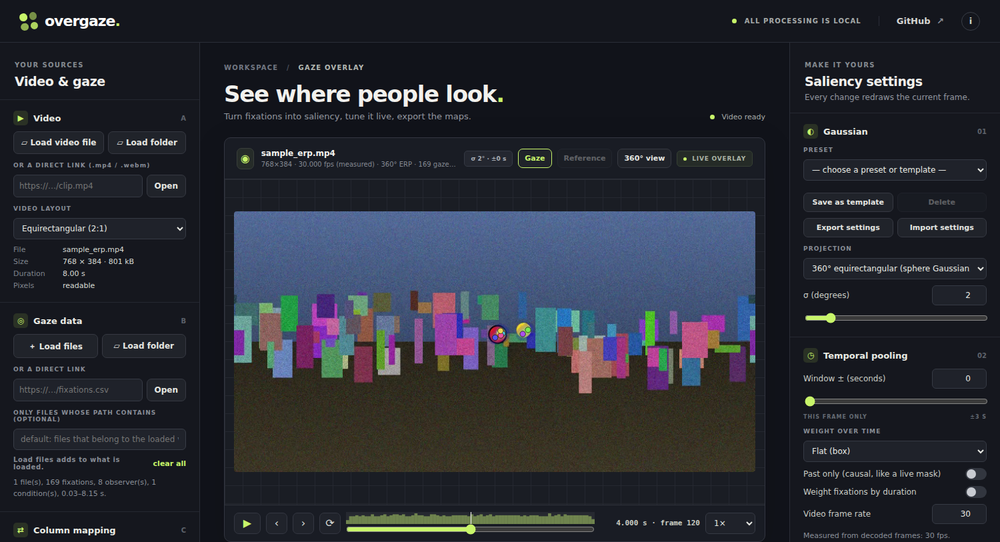

## Run locally

Serve the repository root with any static web server, then open it in Chrome:

```sh
python3 -m http.server 8000
# open http://localhost:8000
```

Do not double-click `index.html`: a page opened as a file cannot load its scripts, so nothing would work. OverGaze detects this and shows a red banner that says so. Local video files are opened in memory, so seeking works with any server.

## Host on GitHub Pages

Push the repository (`index.html`, `styles.css`, `src/`, `sample/`) to a branch, then **Settings → Pages → Deploy from a branch**, that branch and **/(root)**. The site is then at `https://<user>.github.io/OverGaze/`. Do not commit private datasets. All paths in the app are relative, so it works under a sub-path.

The address bar can open data and set options: `?sample` or `?sample=2d` load a bundled sample; `?video=<url>&gaze=<url1>,<url2>` loads a video and gaze files from links; `sigma=3`, `window=1`, `kernel=gaussian` (or `box`, `triangle`, `peaked` with `tau=0.25`), `past`, `velocity=75`, `rotate=<degrees>` set options. Linked files must be served with CORS headers (see below).

## Inputs

**Link to the original.** When a downloaded video's file name says where it came from (YouTube: `ID-START.webm` as in the YT360 dataset, yt-dlp's `Title [ID].webm`, or a `youtube.com/watch?v=` / `youtu.be/` link in the name; Vimeo: `vimeo.com/123456` or `vimeo_123456`), panel A shows **open on YouTube ↗** (or Vimeo). It opens the original in a new tab at the moment shown: a full download plays on the original's own clock; a file cut at the dataset's clip start is shifted by that start. settings.json records the original under `video.original`.

**Video.** A local file (anything the browser plays: H.264, VP9 or AV1 in MP4 / WebM; H.265 only in some browsers) or a direct link to a video file. A link whose server sends no CORS headers still plays and gets the heatmap overlay and map export, but the browser does not let the page read its pixels, so motion analysis, snapshots and overlay recording are disabled. YouTube pages cannot be used: the page gets no access to the frames and YouTube shows a 360° viewport, not the ERP frame. Download the file (for example with yt-dlp) and open it from disk.

**Frame rate.** Browsers do not report it. For MP4 and MOV files OverGaze reads it from the file header as soon as the video loads (exact, without playing). For other files it plays a hidden, muted copy right after loading, measures the decoded frames and snaps the result to a common rate (23.976, 24, 25, 29.97, 30, 59.94, 60 …); on a busy computer it tries again with longer waits. Until then it uses 30, so gaze given in frame numbers is re-timed once the rate is known. WebM stores times in whole milliseconds, so the gaps of a 29.97 fps video alternate between 33 and 34 ms; the gaps are averaged, not sampled. You can also type the rate. This matters when a container says 29.97 and the video is really 25.

**Gaze.** CSV, TSV, semicolon- or space-separated text, JSON (array of records) or ARFF, as single files, several files (one per observer) or a whole dataset folder (**Load folder**). The column mapping is guessed from header names and value ranges and is fully editable:

- **Time** in seconds, milliseconds, microseconds, frame index from 0 or frame number from 1, plus an optional **time offset**. A frame number gives the centre of that frame (frame *k* covers [k/fps, (k+1)/fps)).
- **Duration** or **end time** for fixations. Without them each row is one gaze sample.
- **Horizontal / vertical** position as normalised 0–1, degrees, radians or pixels. The four "value at edge" fields define the linear mapping to the frame (longitude −180…180 or 0…360, latitude 90 at the top or 0 at the top, y from the bottom …). A **3D direction** option (x right, y up, z forward) is also available.
- **Observer** from a column, the file name, the folder name or none; **condition** from a column, the folder name, the folder above it, the file name or none.

### The datasets this was built for

Both are recognised on sight; their usual settings are filled in and written in the notice under the video.

- **VR-EyeTracking** (`Gaze_txt_files/<observer>/<video number>._<date>_ori_0.txt`, rows `frame,<n>,forward,<head x>,<head y>,eye,<gaze x>,<gaze y>`). The label words are dropped, the eye position (`gaze x`, `gaze y`) is used as fractions of the panorama measured **from the bottom-left corner**, frame numbers count from 1, the observer is the `pNNN` folder, and the speed filter is set to 75°/s. Choose the whole `Gaze_txt_files` folder after loading the video `001.mp4`: only the files whose name starts with `001.` are read (6,672 files in the folder, 33 used).
- **YT360-EyeTracking** (`Fixation_per_user_per_video/<condition>/<video id>-<start>/<observer>.txt`, one row per fixation with `eye_rect_x`, `eye_rect_y` from the top, `start_time`, `end_time`, `duration`). Load the video `<video id>-<start>.webm` and choose the whole `Fixation_per_user_per_video` folder: the files of the folder named like the video are read, the six audio-visual conditions are kept as conditions (all pooled by default, switch them on and off in the list), and when the video is the full download (longer than the 30 s clip) the gaze times are shifted by the start time in the name and the playhead jumps there.

- **YT360 per-frame files** (`Fixation_per_video/<condition>/<video id>-<start>/00000037.txt`, one file per frame with `eye_rect_x`, `eye_rect_y`, no times, no observers) also work: the frame number is taken from the file name. Rows with `nan` (the eye tracker lost the eye) are skipped and counted. Choose a clip folder, not the whole `Fixation_per_video` folder (428,520 files). `Fixation_per_user_per_video` is the better source: it has observers and fixation durations.

- **Salient360 videos** (`Video_HE/HE/Scanpaths/{L,R}/<n>_<Name>_fixations.csv`, header in a `#` comment line: index, longitude, latitude, start time, duration, start frame, end frame). Frames are used, not timestamps (the player logged its lag per frame); frame numbers start at 1 and the end frame is included; a new observer starts wherever the index goes back to 0 (51–56 per eye); the eye folder (L / R) is the condition. Choose the `Scanpaths` folder after loading `<n>_<Name>.mp4`.

The box **Only files whose path contains** overrides the automatic choice of files.

### Many videos at once

**Load folder** in panel A takes a folder of videos (for example Salient360's `Video_Stimuli/Stimuli`, 19 videos); pick one in the list or step with ‹ ›. Gaze files and reference maps can then be loaded once for all videos, as folders: every file is remembered, and each time another video is opened, its own fixation files and reference are taken by name and the others are left out. Names match when a folder is called like the video (YT360), a file name starts with the video name and `.` or `_` (VR-EyeTracking, Salient360 `2_Diner_fixations.csv`, `2_Diner_2048x1024x600_32b.bin`), or a folder ends in `_<video name>` (`maps_mc3_vret/vret_001/sal.npy`). Among references a `.bin` is preferred to a `.npy`, and both to images. **Folder** in panel E loads such a reference folder; **clear all** and **Clear** forget the remembered files.

**Load files** and **Load folder** add to what is loaded when the new files have the same columns (one column mapping serves them all). A file counts as loaded already when its name, size and date match, however it was chosen; different files with the same name (say `L/x.csv` and `R/x.csv` chosen one at a time) are both kept and told apart as `x` and `x (2)`; files of another format replace the loaded ones. **clear all** removes every gaze file. In the observer list, × removes one observer (with one observer per file, that file) and *bring back* restores them. Notices and errors close with their ×, and loading another video clears the old error.

**Something wrong?** **Copy debug details** (in the export panel and the help menu) copies a plain-text report: browser and the video codecs it can play, the video (size, frame rate, errors), every gaze file used with its row count, files that could not be read or had other columns, the column mapping and any mapping error, settings, motion analysis, and every notice and error so far. Paste it into a message or bug report.

## Outliers

The gaze is cleaned in a fixed order, and the gaze summary under the files says how many rows each step removed:

1. Rows without a valid time or position (for example `nan` where the eye tracker lost the eye) are skipped.
2. **Drop rows where** (gaze processing panel) removes rows by their values: *column* `<`, `>` or `=` *value*, for a confidence column (`confidence < 0.5`) or a value the eye tracker writes when it loses the eye. **＋ and** adds a part to a rule; a row is dropped only when every part holds, so a lost-eye 0,0 is `x = 0 and y = 0` (two separate rules would also drop real positions where only one of them is 0). Numbers are compared as numbers; `=` also matches text, ignoring case. A row is counted against the first rule that drops it.
3. **Minimum fixation duration (ms)** drops fixations shorter than this (0 = off, e.g. 100 ms). Only for fixation files, with a duration or end column; it is greyed out for gaze samples.
4. **Drop samples faster than (°/s)**: the speed filter, for raw gaze samples.

**Left and right eyes** (panel D). Where the data has both eyes of each person, OverGaze pairs each person's two recordings. Which recording is which eye comes from the names (a folder, condition or observer called L, R, left or right); Salient360 head + eye files loaded without their folders are taken in file order (first file = left eye). Partners come from a shared ID in the names ("p01_L" and "p01_R"); otherwise, as in Salient360, where each file numbers its recordings on its own, by matching: for every left × right pair, the share of the left eye's fixations with a right-eye fixation starting within 60 ms and within 3°, then the best one-to-one assignment, dropping pairs below 0.1. On the 19 Salient360 videos this finds 48–53 people per video with both eyes and 3–10 recordings without a partner. The count is shown under the setting **Left and right eyes** (set it to "keep them apart" to switch pairing off); the setting and the pairs are saved in settings.json. **Load 360° sample, both eyes** opens the sample as a left- and a right-eye file.

When eyes are paired, the observer list shows **one row per person** (for example "L#03 + R#06": recording 3 of the left-eye file and 6 of the right-eye file), with the left eye (circle) and right eye (square) underneath; click the name to open or close it. The person's checkbox and × act on both eyes; each eye can still be switched off or removed on its own (its partner then stays as a one-eye person). **Sort by agreement** orders people by their score, the mean of their eyes' scores, with each eye's score in its own row; people far below the others are marked ⚠ (the same box-plot rule). settings.json lists the recordings switched off and the people's scores.

**Observer agreement** (panel D): for each observer, the correlation between their map and the summed map of all the other observers (leave one out), at 128 × 64, averaged over up to 400 frames spread over the clip. It uses the current saliency settings (σ, pooling window, motion compensation). Observers are compared only with others of the same condition (in Salient360 the conditions are the left and right eye of the same people), each pixel is weighted by its area on the sphere for 360° video, and frames where the observer or the others have no gaze are left out instead of counting as 0. The score stands next to each observer; **sort by agreement** puts the lowest first, and scores far below the rest are marked ⚠: below the lower quartile minus 1.5 × the spread between the quartiles (the box-plot rule, needs at least 4 observers). This is a flag only: nobody is removed automatically; use × to remove an observer. There is deliberately no filter for gaze that is far from everyone else: in 360° video, people looking somewhere different is real data.

The rules, the minimum duration, what each step removed, the removed observers and the agreement scores are written into `settings.json` (section `gaze_processing`); **Export settings** keeps the rules and the minimum duration, and **Import settings** restores them.

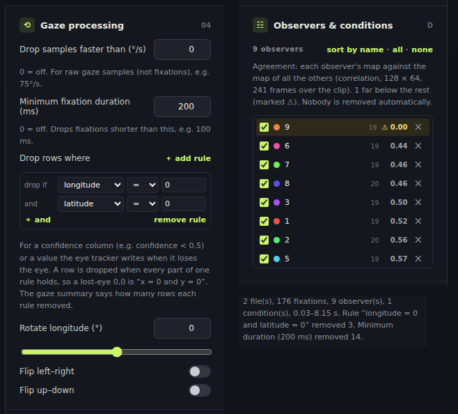

## Reference maps

**Load reference** in panel E opens ground-truth maps to compare with, read frame by frame from disk (multi-gigabyte files are fine):

- a Salient360 `.bin` sequence (`<n>_<Name>_<width>x<height>x<frames>_32b.bin`, raw float32); the frame offset is set to +1 because bin frame 0 is empty and bin frame k belongs to video frame k − 1,
- a `.npy` array (frames, height, width) or (height, width), float16 / 32 / 64 or uint8, such as the `sal.npy` of the pooled training maps,
- one image (a static map such as `<n>_<Name>_saliency.png`) or one image per frame (ordered by the number in the name).

Reference frame = video frame × *ref. frames per video frame* + *frame offset*. Display: **Reference heatmap** (its own layer under ours, in its own colour map) and **Reference outline** (the area at or above the coverage threshold, white by default) each have a switch; **Outline our coverage area** in the display panel draws ours (lime by default) and switches on by itself when a reference is loaded, unless you set it. Both outline colours can be picked next to their switches. The **Gaze** and **Reference** buttons above the video show or hide everything from one side: **Gaze** our heatmap, gaze points and outline, **Reference** the reference heatmap and outline. They leave the switches as they are, so the same layers come back; switching one of a side's layers on also shows that side again.

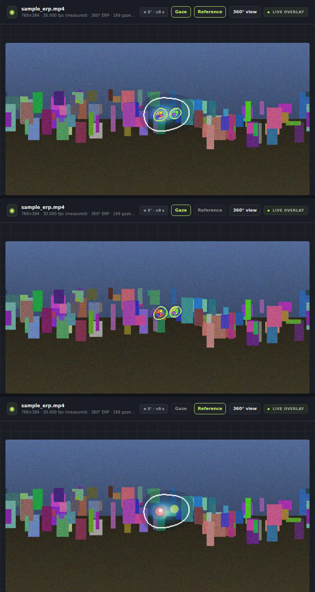

Each outline has its own thickness, in pixels on the screen: **Reference outline thickness** in the reference panel and **Our outline thickness** in the display panel. The outlines are traced as lines between the map's pixel centres and drawn on their own layer at screen resolution, so they look the same at every live map width, window size and zoom. In the 360° view the thickness is kept at the centre of the view while you zoom with the wheel (towards the edges of a wide view the projection stretches it, like everything else). Snapshots and recorded videos keep the outlines as thick, relative to the picture, as they look on screen.

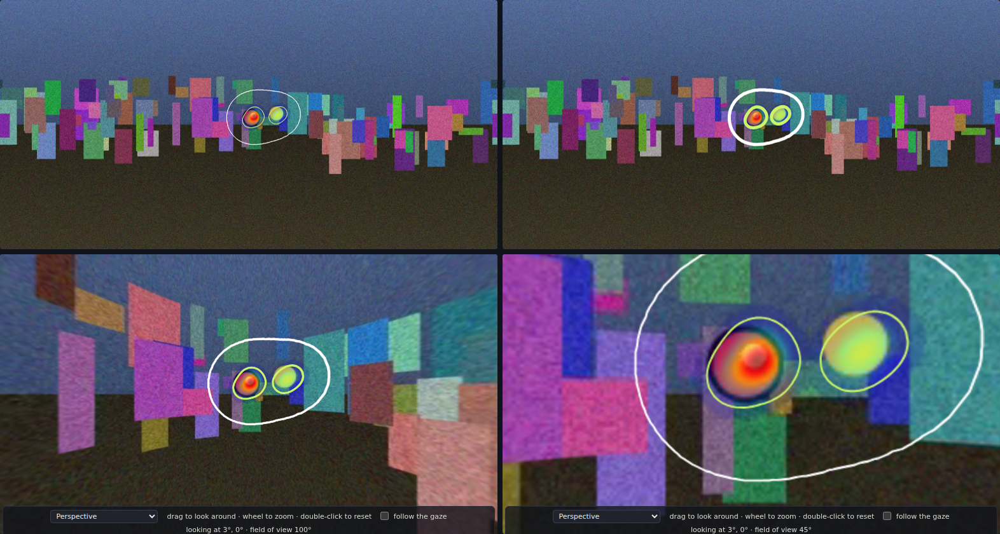

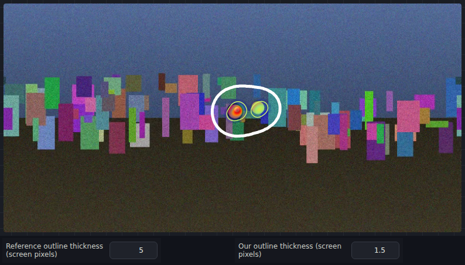

Right after loading, every reference frame is read once in the background, starting at the playhead, and kept small in memory (at most 512 × 256, one byte per value plus the frame maximum: 79 MB for 600 frames); the status line shows the progress (a 4.9 GB Salient360 `.bin` took 25 s). From then on the reference follows playback frame by frame. Frames not prepared yet are read on demand and the newest ready one is shown; **Hold the video for the reference** pauses playback until the current reference frame is there, so video and reference stay together at the cost of speed.

Salient360 note: several of its videos (2_Diner, 5_Waterpark, 8_Sofa, 10_Cows, 18_Bar …) are stored as 3840 × 1920 with non-square pixels, so the browser shows them as 3840 × 2048 or 3840 × 2160. The picture is still the whole sphere, only stretched, and the overlay is stretched with it, so nothing shifts: on 5_Waterpark the map from the fixation files matches the `.bin` at CC 1.000 with 97–98 % overlap. Loading a Salient360 `.bin` also sets the projection to 360°. Switches: **Reference heatmap** (its own layer under ours, in its own colours, “ice” by default) and **Outlines** of the area at or above the coverage threshold (reference white, ours lime). The **Gaze** and **Reference** buttons above the video hide either side completely, so either can be seen alone or both together. The readout **vs reference** gives the correlation of the two maps (CC), the overlap of the two thresholded areas (intersection over union) and the reference's coverage. The **coverage threshold** (display panel, default 0.1 × frame maximum) applies to the outlines, the coverage readout and the coverage written into `frames.csv`; **Outline the coverage area** draws our outline without a reference.

Check: Salient360 `1_PortoRiverside` with both eyes' fixations, σ 2°, window 0, against its `.bin`: CC 1.000 and overlap 98.5 % at 3, 8 and 12.5 s, i.e. the frame alignment and the Gaussian match the dataset's own maps.

## Video layouts and 360° views

**Video layout** (panel A) says how the 360° picture is stored in the video. Other layouts than plain equirectangular are unfolded to an equirectangular frame on the graphics card, and the overlay, motion analysis, snapshots and the 360° view all work on that frame:

| layout | frame | guessed from the shape |
|---|---|---|
| Equirectangular | 2:1 (also stretched 16:9 full-sphere videos) | 2:1 and anything not listed below; shapes from 1.86:1 to 2.15:1 (e.g. 3840 × 2048) also set the projection to 360° |
| Equirectangular, stereo top-bottom | top half used | 1:1 |
| Equirectangular, stereo side by side | left half used | 4:1 |
| Cubemap 3 × 2 | faces right, left, up / down, front, back | — (3:2 is taken as the next one) |
| Cube strip 6 × 1 and 1 × 6 | same face order in one row or column | 6:1, 1:6 |
| Equi-angular cubemap 3 × 2 (YouTube) | left, front, right / down, back, up (bottom row turned), 2-pixel padding | 3:2 |
| Cylindrical panorama | picture wrapped on a cylinder: across = angle, up = height on the cylinder (tan of the elevation); black above and below | wider than 2.2:1 (except 4:1 and 6:1) |

For the cube layouts, **Face order** gives the faces tile by tile from the top left (R L U D F B = right, left, up, down, front, back; default RLUDFB) and **Mirror faces** mirrors each face, like `cubemapOrder` and `cubemapFlipX` in egjs-view360. For a cylindrical panorama, **Horizontal coverage** (default 360°) says how far around the picture reaches; the vertical field of view follows from the shape, 2·atan(π·height / width) for a full turn (115° for 2:1).

The cube layouts follow ffmpeg's `v360` filter (default face order and rotation), which is how such files are usually made: unfolding ffmpeg's cubemap and equi-angular cubemap output gives exactly ffmpeg's own equirectangular result (`tools/fit_cube_faces.mjs` fits the face table). The cylindrical mapping matches ffmpeg's `cylindrical` output to within rounding (mean error 0.2 of 255). A browser test makes cubemap (default and LRDUBF face order), equi-angular cubemap and cylindrical videos of the sample with ffmpeg and checks that each unfolds to the original frame. A YouTube equi-angular cubemap download (YT360 `AnfsPA5FXh4-1215`, 3840 × 2160) unfolds without seams, with the fixations on the people and the crossing. Choose the layout by hand when the shape is ambiguous: 16:9 files can be stretched equirectangular (most YT360 clips) or equi-angular cubemap (that one).

**360° view** (above the video, for videos whose pixels can be read; it treats the frame as equirectangular) shows the frame from inside the sphere with the heatmap, outlines and gaze points on it:

- **Perspective**, like the 360° players of YouTube or VLC (field of view 25–130°),
- **Little planet** (stereographic projection looking down, up to 330°),
- **Fisheye** (equidistant, up to 360°).
- **Unfolded**: the whole sphere laid out as a **cubemap 3 × 2**, an **equi-angular cubemap** or a **cylinder** (360° around, ±57.5° up and down), with the overlay on it; dragging turns the sphere. These match ffmpeg's conversions of the same frame (correlation 0.99; 0.94 for the equi-angular cubemap, where ffmpeg adds a 2-pixel border).

The view menu sets how the frame is *shown*; how the video file *stores* the picture is set by **Video layout** in panel A.

Drag to look around, use the wheel to zoom, double-click to reset. **follow the gaze** turns the view towards the maximum of the current map, smoothly while playing. Exports stay equirectangular.

The list of layouts and views is modelled on [egjs-view360](https://github.com/naver/egjs-view360) by NAVER (MIT licence): its equirectangular, stereo equirectangular, cubemap (with face order and mirroring), cube strip, equi-angular cubemap and cylindrical projections and its little-planet view. OverGaze does not include its code; the shaders are written for OverGaze.

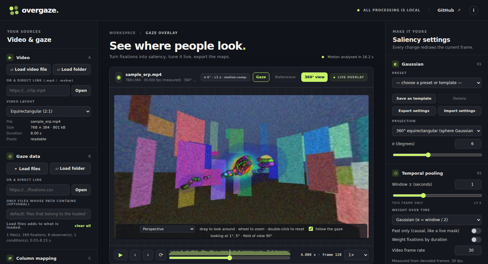

## Settings

All settings redraw the current frame and are written into `settings.json` with every export.

| setting | meaning |
|---|---|
| Projection | **360° ERP**: each point adds `exp(−θ² / 2σ²)`, θ = great-circle angle to the point, so blobs widen correctly towards the poles and wrap across the left/right edge. **2D video**: a Gaussian in the image plane, σ in pixels = σ(°) × width / horizontal field of view. |
| σ (degrees) | Gaussian standard deviation. Kernel cut at 3σ. |
| Window ± (s) | Temporal pooling. A gaze sample counts for the frame if its time is within the window of the frame centre (plus half a frame); a **fixation** counts once for every frame it covers, like per-frame fixation sets. 0 = only what is active in the frame. |
| Weight over time | Flat, triangle (fades to zero at the window edge), **Gaussian (σ = window / 2)**, or **peaked at the current frame**: weight exp(−\|Δt\| / τ), 1 at the current frame and 0.37 at τ seconds away (τ, the time constant, is set next to it; 0.25 s by default). The window still limits how far back and ahead gaze is taken. |
| Past only | Causal pooling: only gaze up to this frame. What a live, deployed mask could use. |
| Weight by duration | Multiplies each fixation by its duration. |
| Motion compensation | See below. |
| Speed filter | Drops samples whose angular speed to the previous sample of the same observer exceeds the threshold (raw gaze, e.g. 75°/s). |
| Rotate / flip | Longitude offset and left–right / up–down flips, for orientation checks. |
| Display | Heatmap (alpha rises with saliency), flat heatmap, spotlight (darkens what nobody looks at), grey map as exported, or off; colour map, opacity, gamma, live map width, gaze points coloured by observer. |

### Presets, templates, import and export

The **Preset** list (top of the settings) sets everything that changes the maps at once, and says where the values come from:

| preset | σ | window | other | source |
|---|---|---|---|---|
| Salient360: head + eye maps | 2° | this frame | both eyes (L + R files), no speed filter | David et al., MMSys 2018 and the dataset readme: a 2° Gaussian per eye fixation, both eyes combined, one map per frame; fixations were parsed by the authors (below 80°/s, at least 80 ms). Matches the `.bin` maps at CC 1.000. Set automatically when Salient360 fixation files are recognised. |
| Salient360: 200 ms pooling | 2° | ±0.1 s, flat | | the paper's comparisons (section 4.2): frames pooled in 200 ms intervals, summed and normalised |
| Salient360: head-only maps | 3.34° | this frame | | the dataset's head-only maps (viewport centre of each head sample) |
| Video-saliency training maps “mc3” | 3° | ±1 s, Gaussian (σ 0.5 s) | motion compensation, 75°/s for raw gaze | the pooled VR-EyeTracking / YT360 training maps (see [docs/validation.md](docs/validation.md)) |
| Live mask | 3° | past 1 s, fading | causal | what a real-time mask could use |
| OverGaze defaults | 2° | this frame | | |

Once any of these settings differs from the chosen preset or template, the menu shows **(custom <preset name>)** and a line under it lists what changed. Choosing the preset itself again restores its values. Only the settings a preset sets are compared: the defaults say nothing about the projection, so they stay "not custom" on 2D video. A motion-compensated preset is not counted as changed while it waits for **Analyse motion**.

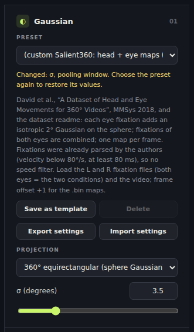

**Save as template** keeps the current settings under a name in this browser (they appear under *My templates*; **Delete** removes one). **Export settings** downloads them as a small `.overgaze.json` file; **Import settings** reads such a file, or the `settings.json` of any map export, applies it and keeps it as a template.

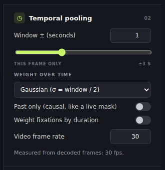

The readout under the video shows the points in the window, the observers that contribute, the time per map and the **coverage**: the share of the frame at or above 0.1 of the frame maximum, per pixel and per sphere area (cos latitude weighted).

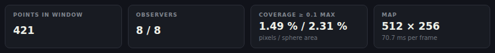

### Scene memory

**Scene memory weight w** (temporal pooling section, 0 = off) adds w × a map of everything people looked at since the clip started: past only, so it also works for a live mask. Each fixation counts by how many frames it lasted so far (each raw gaze sample once), moved along the motion (analysed or loaded) from its last moment to the current frame. The pooled map and the memory map are each divided by their maximum, added, and divided by the maximum again. The memory map is drawn at a quarter of the map width and enlarged (it is broad), and during playback the remembered points are moved on frame by frame instead of from where they were recorded, so it adds about 15 ms per frame on a 20 s Salient360 clip with 110 recordings.

**Outline only the area scene memory adds** (display section, own colour, pink by default) outlines where the map with memory is salient (at or above the coverage threshold) but the pooled map alone is not: the places memory brings back. Scrub through a clip to judge whether those places hold salient things people skipped at this moment. The weight is saved in settings.json under `saliency.scene_memory_weight` (and in presets and templates), the outline under `display.memory_outline`; exported maps include the memory.

On Salient360, "pooled + memory" ranks held-out viewers' fixations better than pooling alone (area under the curve 0.846 against 0.807) but most of that comes from knowing the scene's salient objects at all; see [docs/validation.md](docs/validation.md), sections 5 and 6.

### Gaze points

**Show gaze points** draws one dot per fixation (or raw gaze sample) in the pooling window. **Colour = person**: both eyes of a person share it; the left eye (or a recording without a pair) is a circle, the right eye a square of the same area. The 12 colours are bright, ordered so that neighbours in the list differ most (also for colour-blind viewers), and every dot has a dark edge so it shows on bright video too; with more than 12 people they repeat. Under it, **more**:

- **Dot size** in screen pixels (the same in the 360° view at any zoom).
- **Grow while the eye stays in place**: a dot gains its own size every 0.5 s its eye stays put, up to the cap (× the dot size). Fixation files: by the time into the fixation. Raw gaze samples: while they stay within 1.5° of where the eye arrived.
- **Join each person's two eyes**: a thin dashed line between a person's left- and right-eye dot in the current frame (needs paired eyes).

- **With pooling on** (a window above 0): dots of the current frame are solid with a white edge; dots from earlier moments are rings and from later moments solid but faint, both fading from 0.85 to 0.15 opacity towards the edge of the window. With motion compensation, **a line from where a point was recorded to where the motion moved it** (can be switched off).
- **Legend on the video** (top left; can be switched off): what the shapes and styles mean for the current settings. It is not part of snapshots or recordings.

With 100+ observers the current-frame dots stay on top, nearer moments over farther ones, so the busy pooled cloud does not hide the current gaze. These are saved in settings.json under `display.gaze_points` and read back from a settings file.

### Motion compensation

**Analyse motion** decodes the video at low resolution (128 × 64 to 512 × 256), computes dense optical flow between frames about 1/10 s apart and keeps the velocity fields in memory. **Estimate**: *OpenCV Farnebäck* (default) uses OpenCV's Farnebäck method from OpenCV.js 4.10, which is served from this repository (`vendor/opencv`, about 10 MB) and loaded only when you press Analyse motion; *built-in* is OverGaze's own estimate (pyramidal Lucas–Kanade, then each pixel keeps its own movement, a neighbour's or none, whichever matches the next frame best). Both join the left and right edges for 360° video. **Checks** (on by default): the motion back from the second frame to the first must cancel the motion forward (else 0); textured patches (5 × 5) that changed by less than 3 of 255 get no motion (a flat patch keeps the estimate, since it looks the same whether it moved or not); rows beyond ±70° latitude take the horizontal motion of the last trusted row. Farnebäck with the checks keeps up with real-time playback ("play" grabbing): on a 20 s 4K clip it measured 195 of 200 fields, the built-in estimate with checks 73. With **Use motion compensation** on, every pooled gaze point is moved along the flow from its own time to the frame time, so a panning camera or a moving object keeps its saliency on the object instead of smearing along the path. **Show flow vectors** draws the field (arrow = motion over 0.5 s); **only near the gaze points** limits the arrows to where the pooled gaze points of the window were recorded or moved to, which is where the motion is used.

| without | with motion compensation |
|---|---|
| 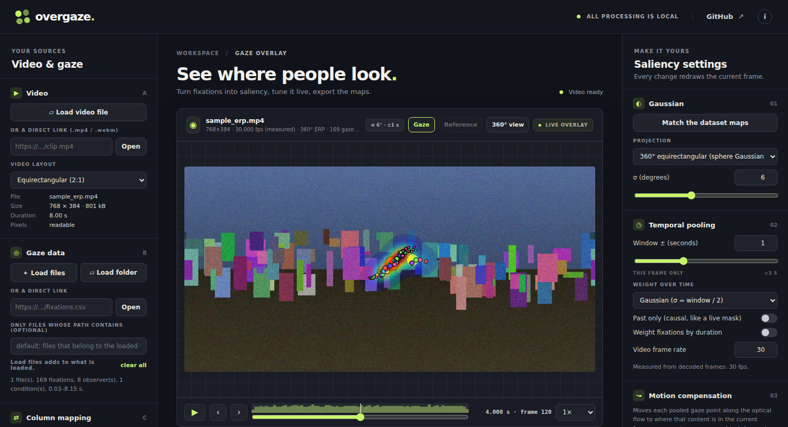 |  |

- *play (fast)* plays the video at normal speed in the background and takes frames as they appear (about as long as the video); *seek (exact)* seeks to each sample time, slower for large videos but independent of decoding speed. Both collapse the sample's smeared map; play mode on a busy machine can lose a flow field, which the store bridges.
- Flow is reliable for camera motion and for large, contrasted objects. Small, fast objects can be missed at low resolution and low sample rates; raise both. Flow is measured in the ERP image, so it is distorted near the poles, like the image itself.
- *Range*: the whole video, the export range, or the **gaze range** (from the first to the last gaze time, plus the pooling window on each side). When gaze is loaded on a video much longer than the gaze (a full YouTube download with 30 s of gaze), the export range and the motion range start out as the gaze range, unless you changed them; a note says so.

**Load motion file (.npz)** uses motion computed outside the browser instead, for example OpenCV's dense optical flow (DIS, dense inverse search), which is more accurate on real video:

```
python tools/motion_opencv.py clip.mp4                # → clip.motion.npz: 256 × 128, 10 fields per second, edges joined for 360°
python tools/motion_opencv.py clip.mp4 --flat         # ordinary 2D video
```

It samples frames the same way as **Analyse motion** (seek). The file holds `t_a`, `t_b` (seconds), `flow` (fields × height × width × 2: pixels moved from the frame at `t_a` to the frame at `t_b`), and optionally `wrap`, `fps` and `method`; any tool that writes these arrays with NumPy (`np.savez` or `np.savez_compressed`) works. The status line and settings.json name the file and its method.

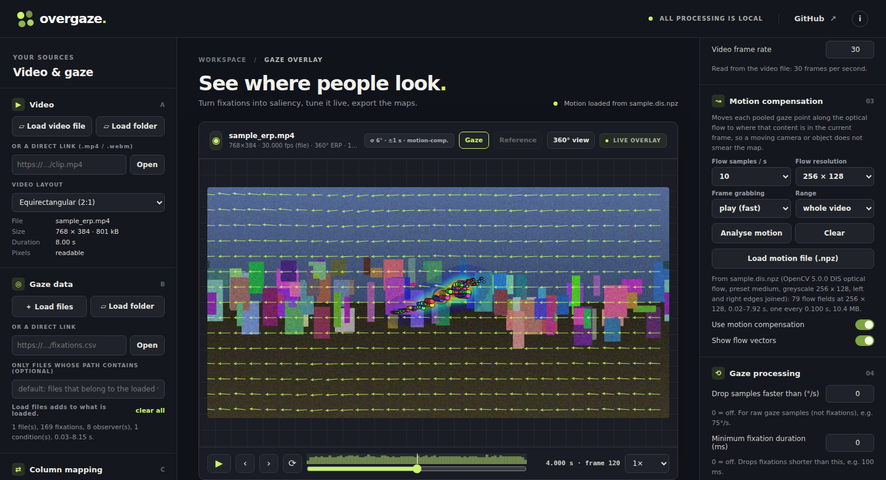

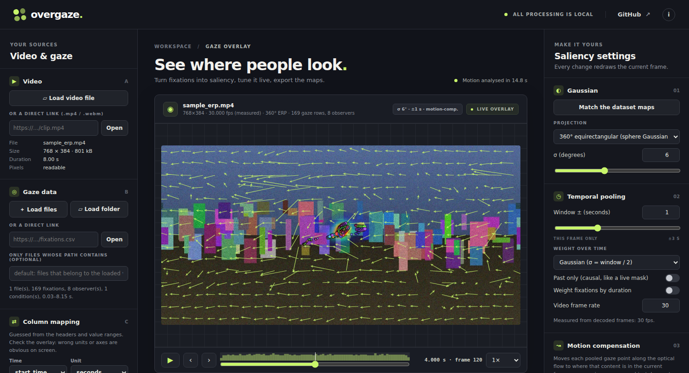

## Export


- **Saliency maps**: frames in a time range, every n-th frame, at a chosen width (128 × 64 up to 3840 × 1920 or the video width; ERP maps are 2:1). One ZIP file containing:
  - `maps/<frame index>.png` as grey 8-bit (`round(255·map)`) or 16-bit PNG, each map divided by its frame maximum,
  - or `maps.npy` with shape (frames, height, width) as float32 (÷ frame maximum, ÷ frame sum, or raw) or uint8; NumPy reads it directly: `np.load(zipfile.ZipFile(path).open('maps.npy'))`,
  - `settings.json` (video, gaze files, column mapping, observers and conditions used, every setting, flow parameters, encoding) and `frames.csv` (frame index, time, number of points, raw maximum, coverage).

  In Chrome and Edge the ZIP is streamed to disk as it is produced (ZIP64 above 4 GB). Other browsers build it in memory.
- **This map (PNG)**, **Overlay snapshot (PNG)** and **Record overlay video** (the video with heatmap and points, recorded in real time over the export range; MP4 where the browser supports it, otherwise WebM).
- **Processed gaze (CSV)**: start, end, longitude / latitude in degrees, u / v, observer and condition after mapping, filtering and orientation changes.
- **Copy settings (JSON)**.

## Samples

**Load 360° sample** opens a synthetic 8-second 360° clip in which the camera pans while a red ball moves on its own, with fixations from 8 simulated observers who mostly follow the ball and sometimes look at a yellow sign. With a ±1 s window the map smears along the ball's path; after **Analyse motion** with motion compensation on, it collapses back onto the ball (coverage drops from about 0.95 % to about 0.4 %).

**Load 2D sample** opens a plain 640 × 360 video with a moving red square and six simulated observers whose gaze is given in pixels.


## Keyboard and mouse

Click on the video: play / pause (in the 360° view a click, not a drag; a double-click resets the view). ⟳ next to the frame buttons (or L): repeat; the menu next to it chooses what: the whole video, the export range or the gaze range (playing from outside the range starts at its beginning). Space: play / pause. Left / right: one frame. Shift + left / right: one second. M: motion compensation on / off. P: gaze points on / off.

## Development

```sh
npm test                         # unit tests (Node) and browser tests (Chrome, skipped if missing)
node tools/screenshots.mjs       # regenerate docs/screenshots from the bundled samples
python3 tools/make_sample.py     # regenerate the 360° sample (NumPy and ffmpeg)
python3 tools/make_sample_2d.py  # regenerate the 2D sample (ffmpeg)
```

The unit tests cover parsing and mapping (including the VR-EyeTracking and YT360 formats), the sphere Gaussian, pooling (Gaussian weights, fixations over frames), the speed filter, optical flow, motion-compensated pooling, frame-rate estimation and the ZIP / NPY / PNG writers. The browser tests start a small static server and a headless Chrome (`tools/cdp.mjs`, no dependencies, Node 22+ for the built-in WebSocket) and check: the sample loads with a clean console and draws the heatmap, `file://` shows the warning, motion compensation shrinks the pooled map, the export ZIP is complete, and a VR-EyeTracking-style folder is filtered and read correctly. Set `CHROME=/path/to/chrome` to choose the browser.

`src/` holds `gaze.js` (parsing and coordinates), `saliency.js` (pooling and Gaussians), `flow.js` (optical flow and the flow store), `motionfile.js` (motion files), `timing.js` and `mp4fps.js` (frame rate), `reference.js` (reference maps), `projections.js` (video layouts), `view360.js` (WebGL unfolding and 360° views), `export.js` (writers), `colormap.js`, the two workers and `app.js` (interface). `window.overgaze` exposes the state, `applySettings(...)` and `mapAt(frame, width)` (the raw map the export would write) for tests and the console.
